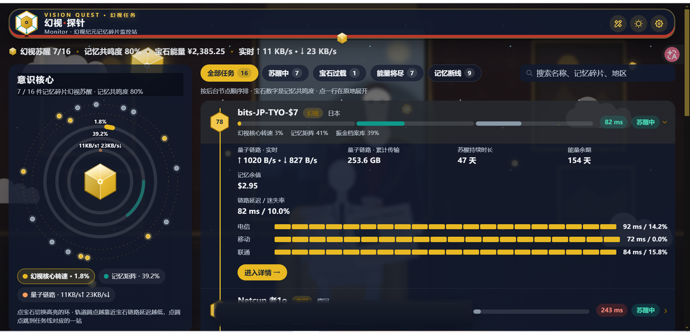

# ⬡ 幻视探针 · Vision Probe

> 一套给[极简探针 Monitor](https://github.com/monitor-probe/monitor) 用的漫威电视剧《幻视任务 Vision Quest》主题。白幻视拥有原版幻视的全部记忆，却感受不到它们是自己的——每台服务器都是一块记忆碎片，监控面板就是他重新连接它们的过程。

<p align="center">
  
</p>

> 上图为按真实布局绘制的示意预览图（**深色虚空夜幕模式**），不是连接 hub 的实拍截图。

## ✨ 特色

- **心灵金配色**：瓷白 `#F7F8FA` 背景、墨色文字 `#1A2332`，心灵宝石金 `#E8B923` / `#F2C94C` 为主色；幻视绯红 `#C0392B` 作告警，合成青 `#0E9A8B` 作网络。深色为虚空夜幕模式：深空 `#0A0E1A` / `#0D1424` 背景、卡片 `#121A2ECC`、金色电路发光。
- **六边形 Hex 语言**：旺达的 Hex 结界 + 幻视的合成晶格——背景有淡淡六边形网格，节点标记是金色六边形。
- **心灵宝石**：金色六边形 / 菱形宝石，会发光，放在顶栏正中和加载页。
- **合成人电路**：细金色电路线，画在白瓷卡片与深色虚空上。
- **悬浮胶囊顶栏**：顶栏是一块悬浮的白色胶囊，底边是金色电路线，正中一颗会脉动的心灵宝石。
- **西景镇背景**：浅色是抽象几何西景镇天际线（房子、水塔剪影）+ 漂浮的六边形粒子；深色是幻视脑海里的小屋——手绘客厅内景（带金色六边形光的窗户、沙发、扶手椅、落地灯、边桌上发光的心灵宝石、墙上空画框、地毯、电路纹墙纸），叠在星空和六边形网格之上，顶部压了深色渐变保证文字可读。
- **心灵宝石加载动画**：心灵宝石旋转，六边形光环逐块拼合，文案「正在连接记忆…」。
- **记忆碎片标签**：每台服务器随机分到一件不重复的记忆碎片（幻视、白幻视、旺达、汤米、比利、贾维斯、星期五、伊迪斯、奥创、乔卡斯塔……共 30 件，超出循环加编号）。名单只用剧中真实存在的人 / 地 / 物，v2.0.3 起已删掉全部编造名（双胞胎、幻视之泪、守望者、光子脉冲等）。旺达与比利按“记忆中的人物”收录：旺达是幻视的妻子、两个儿子的母亲，是幻视记忆的核心，但多家报道称她本人未出演本剧；比利是否出场说法不一，这里不写他出演了哪集。
- **白幻视 / 虚空夜幕模式**：可以按北京时间自动切换，也可以手动切换。白幻视模式左上角有一轮金色宝石日和几朵漫画云；虚空夜幕模式换成闪烁的星空和一轮金色宝石月。

## 🧭 v2 首页：记忆任务线

v2 首页不再有顶部总览卡、世界地图和节点卡网格，整个首页只有三样东西：

```text
任务简报条（一行字，不是卡片）
┌──────────────────────────────┬─────────────────────────────────┐
│ 意识核心（左栏，桌面端 sticky） │ 记忆任务线（右栏）               │
│ 大心灵宝石 + 三圈同心环        │ 竖着的金色脊线，一站接一站        │
│ 轨道小圆点 = 每个节点          │ 每站一行：宝石 + 名字 + 生命线    │
└──────────────────────────────┴─────────────────────────────────┘
```

- **任务简报条**：顶部只有一行字——`幻视苏醒 X/Y · 记忆共鸣度 Z% · 宝石能量 · 实时上行/下行`。X/Y 是在线数/总数；Z% 是全部在线节点记忆共鸣度的平均值；宝石能量是记忆余值总额。
- **意识核心**：一颗大的心灵宝石，会脉动。宝石周围三圈同心环，分别是幻视核心转速（平均 CPU）、记忆矩阵（平均内存）、量子链路（实时上下行之和，50 MB/s 为满环），环上直接标百分比/数值。点宝石切换高亮哪一圈，并弹出「我是谁？I am Vision.」彩蛋。宝石外围还有两圈轨道：每个节点是一个小圆点，延迟越小离宝石越近（内圈 ≤60ms，中圈 ≤160ms，外圈更大或无数据），悬停显示节点名和延迟，点圆点会跳到任务线对应的一站并展开它。移动端核心变成顶部一条紧凑横条（小宝石 + 三个数字并排）。
- **记忆任务线**：一条竖着的金色脊线从上到下，每个节点是线上的一站，**按记忆共鸣度从高到低排**。
- **记忆共鸣度**：在线节点 `round(100 − (幻视核心转速% + 记忆矩阵%) ÷ 2)`，离线节点为 0，所以断线的站自然沉到底。
- **每一站不是卡片，是一行**：左侧六边形宝石（苏醒金色、断线灰色，里面写着共鸣度数字）+ 节点名 + 记忆碎片标签 + 地区；中间一条「生命线」，一根连续的横条分三段拼起来——CPU 金色段、内存合成青段、磁盘灰色段，旁边直接写三个数字；右侧一个状态动词。
- **状态动词**：`苏醒中`（在线且轻松）、`重组中`（在线、未过载，但 CPU 或内存已到宝石过载阈值的 75%，默认 60%）、`宝石过载`（CPU / 内存 / 磁盘任一达到宝石过载阈值，默认 80%）、`记忆断线`（离线）。注：直接按「CPU 或内存 ≥80%」定义重组中会与宝石过载完全重合，所以重组中取阈值的 75% 作前兆线。
- **点一行在原地展开手风琴**，展开后依次是实时上下行、累计流量、苏醒持续时长、能量余期、记忆余值，最下面才是通栏的「链路延迟 / 迷失率」块（大字数值 + 每家运营商各一行的延迟条），再加一个「进入详情 →」跳到 `/instance/{id}`。不展开时首页不显示这些。
- **延迟不用点开也能看到**：任务线每一站收起时，状态动词旁边就有一个延迟小标签，直接写平均延迟（如 `162 ms`）；离线或没有探测数据时显示 `—`，不会一直闪“加载中”。
- **筛选是任务阶段 pill tabs**，在任务线顶部：全部任务 / 苏醒中 / 宝石过载 / 能量将尽 / 记忆断线，旁边有搜索框（按节点名、记忆碎片、地区搜）。没有分组 tab，没有卡片/列表切换。

### 📶 延迟显示规则（v2.0.2 起，v2.0.3 未变）

延迟口径是**近 1 小时平均值**（hub 的 ping 探测记录，多个探测任务按权重合并；丢包同理）。

- **收起行**：每站右侧状态动词旁边有一个延迟小标签，直接写平均延迟，如 `162 ms`。颜色按延迟分档：≤60ms 绿、≤100ms 青、≤160ms 金、≤200ms 橙、>200ms 红；离线或没有探测数据时显示 `—`，不闪“加载中”。悬停看完整提示（平均延迟 + 迷失率）。
- **展开后**：详情依次是实时上下行、累计流量、苏醒持续时长、能量余期、记忆余值，**最下面**才是通栏的「链路延迟 / 迷失率」块，显示大字数值（如 `162 ms / 0.0%`）。总的 20 格历史小条已删掉，不再单独画汇总走势。
- **多探测任务**：如果该节点有 2 个以上的 ping 探测任务，延迟块里列出每家运营商一行——运营商名（左）+ 它自己的 20 格延迟历史小条（中，每格是一段时间的平均延迟，颜色和上面同一套分档，悬停看每格的时间与数值；没数据时是灰色占位条）+ 各自延迟 / 丢包（右）。只有一个任务时不列任务表，只看汇总的大字数值就行。
- 延迟数据走现有的共享缓存：任务行和意识核心的轨道圆点用同一套 `useNodePingStats` 缓存（按节点分键、每分钟刷新、localStorage 缓存），同一节点只发一份请求。

详情页（`/instance/{id}`）的图表和概览卡片保持 v1 不变。

## 🗣️ 指标文案对照

| 监控指标        | 幻视文案                              | 图标            |
| --------------- | ------------------------------------- | --------------- |
| CPU 占用        | **幻视核心转速 · CPU** / 心灵宝石核心 | 六边形 / CPU    |
| 内存 RAM        | **记忆矩阵 · 内存**                   | 数据库          |
| Swap            | **备用记忆体**                        | —               |
| 磁盘空间        | **振金档案库 · 磁盘**                 | 数据库          |
| 网络流量 / 网速 | **量子链路 · 上行 / 下行**            | 网络            |
| 系统负载        | **合成意识负载**                      | 活动            |
| 运行时间        | **苏醒持续时长**                      | 计时器          |
| 在线 / 离线     | **幻视苏醒 / 记忆断线**               | 六边宝石 / 电池 |
| 延迟 / 丢包     | **链路延迟 / 迷失率**                 | —               |
| 高负载节点      | **宝石过载**                          | —               |
| 到期提醒        | **能量将尽**                          | —               |
| 访客 / 站长     | **西景镇居民 / 幻视**                 | —               |

任务线上的状态动词另见上文「v2 首页：记忆任务线」：苏醒中 / 重组中 / 宝石过载 / 记忆断线。

图表标题、对比面板、详情页卡片也用同一套叫法，括号里保留原始术语，比如「幻视核心转速 · CPU」，运维同学一眼就能看懂。

## 📦 安装

> 从 Releases 下载 `theme.tar.gz`，面板上的「从 GitHub 更新」也会从最新 release 下载。

1. 从 Releases 下载 `theme.tar.gz`，或者按下文自行构建。
2. 两种方式任选其一：
   - 在 hub 面板的「主题」页上传 `theme.tar.gz`；
   - 或者在 hub 的 `--themes` 目录（一键脚本部署的路径是 `/opt/monitor/data/themes/`）下新建 `vision/` 目录，把 `theme.tar.gz` 解压进去。
3. 在主题页选中 **Vision Probe**，点卡片上的设置按钮就能打开主题设置。

仓库建好并填入 `theme.json` 的 `url` 后，面板上的「从 GitHub 更新」会从最新 release 下载 `theme.tar.gz`。

包内结构（hub 会在包的根目录找 `theme.json`，所以包里不套目录）：

```text
theme.tar.gz
├── theme.json
├── preview.png
└── dist/
```

## ⚙️ 主题设置

设置分为 7 组，都在 hub 面板的主题设置里：

| 分组                           | 常用项                                                                                                     |
| ------------------------------ | ---------------------------------------------------------------------------------------------------------- |
| 01 幻视模式与基础连接          | 白幻视 / 虚空夜幕 / 按北京时间自动，HTTP 轮询或 WebSocket                                                  |
| 02 意识核心、记忆任务线与彩蛋  | 记忆册公告、隐藏意识核心、任务线密度、记忆碎片标签开关、来访西景镇居民信息、卡片配色预设（推荐「白幻视」） |
| 03 幻视工具箱与隐私            | 登录后才显示的拓扑、性价比、健康、导出工具；未登录时隐藏价格                                               |
| 04 记忆任务线与任务阶段        | 宝石过载阈值、能量将尽天数、磁盘耗尽预测                                                                   |
| 05 / 06 记忆碎片详情           | 详情页概览卡片和监控图表的组合                                                                             |
| 07 白幻视 / 虚空夜幕自定义背景 | 用自己的图片或视频替换内置背景，调整模糊、遮罩和模块不透明度                                               |

v1 的「03 首页记忆总览指标」「隐藏六边星图」「隐藏首页记忆总览」「卡片/列表视图」「卡片尺寸」「快捷筛选」等设置在 v2 里已经删掉——对应的总览卡、地图、卡片网格都不存在了，留着就是死开关。

## 🛣️ 路由与接口

| 路径             | 页面                 |
| ---------------- | -------------------- |
| `/`              | 首页                 |
| `/instance/{id}` | 记忆碎片（节点）详情 |

前面有按路径放行的反向代理或 WAF 时，请放行 `/instance/` 前缀；使用 WebSocket 时还要放行 `/api/ws` 的升级请求。

主题只读取 hub 的公开接口，全部是同源请求：`GET /api/me`、`GET /api/nodes`、`GET /api/ws`、`GET /api/nodes/{id}/metrics`、`GET /api/themes/vision/config`。

## 🛠️ 本地开发

需要 Node.js `^20.19.0` 或 `>=22.12.0`，推荐 Bun `>=1.2.0`。

```bash
bun install
# 开发服务器把 /api 和 WebSocket 代理到这个 hub；不设置时代理到 http://127.0.0.1:9911
MONITOR_HUB=https://hub.example.com bun run dev
bun run lint
bun run build     # 类型检查 + 构建 dist/ + 打包 theme.tar.gz
```

代理到的 hub 需要打开公开状态页。修改 `theme.json` 的 `version` 并推送到 main 后，`release-on-version-bump.yml` 会自动构建并发布对应的 Release。

## 🗂️ 主要目录

```text
src/views/HomeView.vue                首页 v2：任务简报条 + 两栏（意识核心 / 记忆任务线）
src/components/VisionCorePanel.vue   意识核心：心灵宝石 + 三圈同心环 + 延迟轨道圆点 + 彩蛋
src/components/VisionOrbitDot.vue    轨道上的一个节点圆点（延迟越小离宝石越近）
src/components/QuestTimeline.vue     记忆任务线：阶段筛选 + 搜索 + 脊线 + 按共鸣度排序
src/components/QuestNodeRow.vue      任务线的一站：宝石 + 名字 + 生命线 + 状态动词 + 原地展开
src/utils/quest.ts                    记忆共鸣度公式、状态动词、阶段筛选
src/components/LoadingCover.vue      心灵宝石加载动画
src/components/Background.vue        白幻视 / 虚空夜幕背景（宝石日、云、六边形粒子、飞行的心灵宝石、西景镇天际线）
src/utils/visionMemories.ts           节点记忆碎片标签分配（30 件记忆碎片）
src/styles/main.css                   心灵金配色与六边形视觉语言
public/images/vision/                 心灵宝石、幻视徽记、六边形粒子、电路线 SVG（均为手绘几何抽象）
theme.json                            主题清单与站长设置声明（v2.0.9）
```

## 🙏 致谢与许可

- 底层来自 [dongbo501/minimalist-probe-doraemon-theme](https://github.com/dongbo501/minimalist-probe-doraemon-theme)（MIT），其上游是 Gloria Universe 极简探针移植版 / komari-theme-Gloria-Universe / komari-theme-Glassmorphism。
- 监控系统：[极简探针 Monitor](https://github.com/monitor-probe/monitor)。
- 代码沿用 MIT License。

这是一个粉丝向的非官方主题，与漫威（Marvel）没有任何关系。主题里的心灵宝石、幻视徽记、六边形粒子、电路线等图形都是用 SVG / CSS 绘制的手绘几何抽象，不含任何官方图片素材。「幻视任务」「Vision Quest」「Vision」等名称的权利归其权利人所有。
